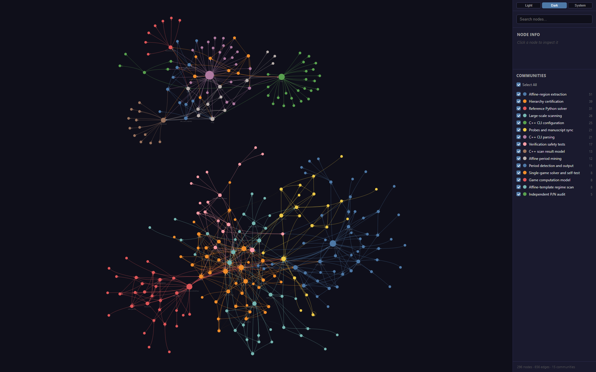

# Research notes

`current_findings.tex` is a standalone LaTeX breakdown of the current results:

- the game and the exact row recurrence;
- Theorem A (interval geometry and eventual periodicity);
- Theorem B (the certified `A = 86` regime);
- Theorem C (universal rows, closed-form run hierarchy, residue templates);
- the certified regime hierarchy through `j = 13` (10,323 pairs);
- boundary behavior and upper deficits;
- a new candidate closed form for the upper endpoint `K_j`, stated as a conjecture;
- new upper-endpoint probes at `j = 15` (`A = 87382`, `K = 80099`),
  `j = 17` (`A = 349526`, `K = 320399`), `j = 19`
  (`A = 1398102`, `K = 1281593`), `j = 21`
  (`A = 5592406`, `K = 5126371`), and `j = 23`
  (`A = 22369622`, `K = 20505487`);
- status, verification commands, constants, and a probe log.

## Repository map

A Graphify-generated code map is in [`graph/`](graph/README.md):

- [`graph/graph.html`](graph/graph.html) — interactive graph (download and
  open in a browser);
- [`graph/GRAPH_CALLFLOW.html`](graph/GRAPH_CALLFLOW.html) — architecture and
  call-flow view;
- [`graph/GRAPH_REPORT.md`](graph/GRAPH_REPORT.md) — communities, hubs, and
  knowledge gaps.



The map indexes 31 Python/C++ files (296 nodes, 656 edges, 15 communities).
The LaTeX manuscripts and certificate data are not part of the code graph; the
hand-authored research pipeline in [`graph/README.md`](graph/README.md) shows
how they connect.

Compile from this directory:

```console
pdflatex current_findings.tex
pdflatex current_findings.tex
```

The document is standalone and does not modify the canonical manuscripts under
`paper/`. If the candidate endpoint law is later proved, it should be promoted
into `paper/theorems/theorem_C.tex` and the Overleaf copies via
`src/sync_manuscripts.py`.

## New `j = 15` endpoint probe

The probe used the repository certifier directly:

```console
python -c "import sys; sys.path.insert(0,'src');
from verify_hierarchy import certify, falsify;
print(certify(80099,87382));
print(falsify(80100,87382))"
```

Observed:

- `certify(80099, 87382)` succeeds with period `247582`, window start `0`,
  bridge `327680`, least start period `247582`;
- `falsify(80100, 87382)` returns first failure `n = 334966`;
- `certify(60074, 87382)` succeeds at the lower endpoint;
- `falsify(60073, 87382)` returns first failure `n = 60074`.

This certifies the endpoint `k = 80099` for all heap sizes, but it does not
certify every `k` in `60074..80099`. The full interval remains open.

## New `j = 17` upper-endpoint probe

For `j = 17`, `A = 349526`, the law predicts `K = 320399` and `d = 29127`.
The upper endpoint was checked with the same window-and-bridge conditions:

```console
python -c "import sys; sys.path.insert(0,'src');
from fast_solver import fast_interval_solver;
k=320399; A=349526; p=2*k+A+2; bridge=k+p-1;
rows,starts=fast_interval_solver(k,1,bridge);
print(rows[0:k]==rows[p:p+k]);
print(any(starts[n] != (n%p in (0,A,k+A+1)) for n in range(bridge+1)));
print(all(starts[n]==starts[n%p] for n in range(bridge+1)))"
```

Observed: the `k`-row window repeats at `t = 0`, the template matches through
the bridge `1310724`, and the least-period check passes. The adjacent
`k = 320400` fails first at `n = 1339854 = p + A` with `p = 990328`.
The lower endpoint `k = 240298` matches the template through the first bridge
`1070421`, but the `t = 0` window does not repeat and the certifier's wider
window search timed out; it is not certified. This certifies
the upper endpoint only, not the whole interval.

## Further probes: `j = 19` and `j = 21`

The repository's `fast_interval_solver` stores full rows as Python bitmasks and
exhausts memory at `j = 19`. `notes/compact_probe.py` uses the same `m = 1`
recurrence with a compact row encoding (empty / full / at most a three-element
interval). It reproduces the `j = 15` and `j = 17` results and handles the larger
cases.

For `j = 19`, `A = 1398102`, `k_min = 961194`, `K = 1281593`, `d = 116509`:

- lower endpoint: window start `961194`, period `3320492`, bridge `5242879`,
  template/least-period/row-equality checks pass; `k = 961193` fails at
  `n = 961194`;
- upper endpoint: window start `0`, period `3961290`, bridge `5242882`,
  template/least-period checks pass; `k = 1281594` fails at
  `n = 5359394 = p + A`.

For `j = 21`, `A = 5592406`, `k_min = 3844778`, `K = 5126371`, `d = 466035`:

- upper endpoint: window start `0`, period `15845150`, bridge `20971520`,
  template/least-period checks pass; `k = 5126372` fails at
  `n = 21437558 = p + A`;
- lower endpoint not certified.

Reproduce with:

```console
python notes/compact_probe.py --k 961194 --A 1398102 --mode lower
python notes/compact_probe.py --k 1281593 --A 1398102 --mode upper
python notes/compact_probe.py --k 5126371 --A 5592406 --mode upper
```

## Streaming probe for larger `j`

`notes/lean_probe.py` checks the same upper-endpoint conditions as
`compact_probe.py` without storing the full row or start arrays. It keeps only
the two endpoint arrays plus the first `k` rows, so it scales to `j = 23` and
beyond. It reproduces the `j = 17` and `j = 19` upper-endpoint results:

```console
python notes/lean_probe.py --k 320399 --A 349526
python notes/lean_probe.py --k 1281593 --A 1398102
```

The `upper-fail` mode streams the same recurrence and reports the first template
mismatch for a parameter above the endpoint. It reproduces the known failures at
`j = 15`, `j = 17`, and `j = 19`:

```console
python notes/lean_probe.py --k 80100 --A 87382 --mode upper-fail
python notes/lean_probe.py --k 320400 --A 349526 --mode upper-fail
python notes/lean_probe.py --k 1281594 --A 1398102 --mode upper-fail
```

## `j = 23` upper-endpoint probe

For `j = 23`, `A = 22369622`, `k_min = 15379114`, `K = 20505487`,
`d = 1864135`. The streaming probe certifies the upper endpoint:

- window start `0`, period `63380598`, bridge `83886084`;
- template and least-period checks pass.

The adjacent parameter `k = 20505488` fails first at
`n = 85750222 = p + A`, the upper-failure pattern. The lower endpoint
`k = 15379114` was not certified.

```console
python notes/lean_probe.py --k 20505487 --A 22369622
python notes/lean_probe.py --k 20505488 --A 22369622 --mode upper-fail
```
