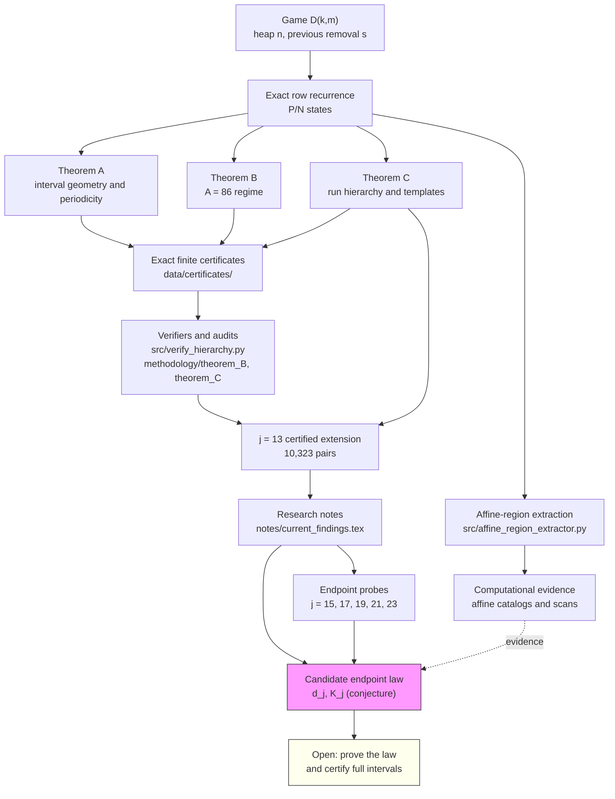

# Repository map

This directory contains a code-level map of the repository generated with the
open-source [Graphify](https://graphify.com) engine (`graphifyy 0.9.104`).
The hosted Graphify MCP workspace available to this session did not have this
repository indexed, so the map was built with the official open-source Graphify
engine locally from the working tree at HEAD `e485fcc1`. The map is a snapshot;
rerun the commands below after code changes.

## View the map

| File | What it is |
|---|---|
| [`graph.html`](graph.html) | Interactive force-directed graph. Download and open in a browser; click a node for its file and line, filter by community, and search by symbol. GitHub displays the HTML source rather than rendering it. This is the best full view. |
| [`GRAPH_CALLFLOW.html`](GRAPH_CALLFLOW.html) | Architecture and call-flow view with Mermaid diagrams and call tables. Download and open in a browser. |
| [`graph_preview.png`](graph_preview.png) | PNG preview used in the notes README. |
| [`GRAPH_REPORT.md`](GRAPH_REPORT.md) | Community summary, god nodes, surprising connections, and knowledge gaps. |
| [`graph.json`](graph.json) | Raw graph data (296 nodes, 656 edges) for `graphify query`, `path`, `explain`, and re-export. |
| [`labels.json`](labels.json) | Community labels used by the interactive and call-flow views. |
| [`sections.json`](sections.json) | Section grouping used by the call-flow view. |

## Research pipeline

The Graphify map is code-level: it does not contain the LaTeX manuscripts or
the certificate data. This hand-authored diagram shows how the code,
certificates, and research notes fit together.



## What the code graph shows

The graph has 15 communities. The large ones are:

| Community | Nodes | Contents |
|---|---:|---|
| Affine-region extraction | 51 | `src/affine_region_extractor.py`, `src/full_state_analysis.py` |
| Hierarchy certification | 39 | `src/verify_hierarchy.py`, theorem B/C verifiers, `src/verify_j13.py` |
| Reference Python solver | 31 | `src/distance_subtraction_research.py` |
| Large-scale scanning | 26 | `src/large_scale_checks.py`, `src/regime_hierarchy.py`, `src/targeted_scans.py`, `src/fast_solver.py` |
| C++ CLI configuration | 25 | `src/distance_subtraction_research.cpp` (`Args`) |
| Probes and manuscript sync | 21 | `notes/compact_probe.py`, `notes/lean_probe.py`, `src/sync_manuscripts.py` |
| C++ CLI parsing | 21 | `src/distance_subtraction_research.cpp` (parser and help) |
| Verification safety tests | 17 | `tests/test_verification_safety.py`, `src/verify_package.py`, audit checks |
| C++ scan result model | 13 | `src/distance_subtraction_research.cpp` (`ScanResult`) |
| Affine period mining | 12 | `src/distance_subtraction_research.cpp` (affine laws) |
| Period detection and output | 11 | `src/distance_subtraction_research.cpp` (period detection and output) |
| Single-game solver and self-test | 8 | `src/distance_subtraction_research.cpp` (single game and self-test) |
| Game computation model | 8 | `src/distance_subtraction_research.cpp` (`GameComputation`) |
| Affine-template regime scan | 8 | `src/regime_scan.py` |
| Independent P/N audit | 5 | `audits/2026-10-12/independent_pn.cpp` |

The most connected nodes are `Args` (31 edges), `ScanResult` (20),
`fast_interval_solver()` (18), `GameComputation` (12), `analyze()` (11), and
`direct_sg_pn()` (11). The C++ implementation and the Python research stack
form two large, loosely connected clusters; the call-flow view makes the
cross-cluster edges easier to read.

## Scope and limitations

- The extraction is **code-only**. Graphify's local AST extractor indexed 31
  Python/C++ files. It does not parse `.tex`, `.csv`, or `.jsonl`; those files
  need a semantic backend or are outside the code graph. The raw run reported
  43 files with no supported extractor.
- The graph is a map of the implementation, not a proof dependency graph. The
  mathematical implications are in `notes/current_findings.tex` and
  `paper/theorems/`.
- The endpoint law is a **conjecture**. The graph records the code that probes
  it, not a proof.
- Community labels were assigned manually after clustering. Raw community ids
  are in `graph.json`; the readable labels are in [`labels.json`](labels.json).

## Current verification status

- Upper endpoints verified for `j = 15, 17, 19, 21, 23` (odd).
- Lower endpoints verified for `j = 15` and `j = 19` only.
- `j = 23`: `A = 22,369,622`, `K = 20,505,487`, `d = 1,864,135`;
  period `63,380,598`, bridge `83,886,084`.
- The adjacent `k = 20,505,488` fails first at
  `n = 85,750,222 = p + A`.
- Full interval certification for the new odd `j >= 15` cases remains open.

## Regenerate

From the repository root:

```console
graphify extract . --code-only
graphify cluster-only . --no-label
graphify export html --graph graphify-out/graph.json --labels notes/graph/labels.json
graphify export callflow-html . --labels notes/graph/labels.json --sections notes/graph/sections.json --output graphify-out/GRAPH_CALLFLOW.html
```

Then copy the curated artifacts into `notes/graph/`. The `graphify-out/`
working directory (cache, manifest, and intermediate files) is intentionally
not committed.
